# 공식 시나리오북 · 안시성의 불멸

## 독법

공식은 이 패키지의 공통 기준을 뜻하며 역사적 사실 인증을 뜻하지 않는다. G는 업로드 v0.1 복원 요약, N은 신규 소설 장면과 게임 설계, U는 원문 부재다. 상대 일차를 역사 날짜로 바꾸지 않는다.

## 전투·전후 전체 연표

|저장점|상대일차 시각|가용병력|사건|
|---|---|---:|---|
|START|17 10:00|23010|토산 53%, 구원군 18000 출진|
|B004|17 13:40|22706|토산 역습 이후 정찰과 치료|
|B005|17 14:25|22708|중장보병과 기동대 출진|
|B006|17 14:55|22713|협곡 북쪽 접촉|
|B007|17 15:18|22640|서쪽 우회 시도|
|B008R|17 15:51|22411|첫 방어선 돌파, 선발대 탈출 시작|
|B009|17 17:51|21940|두 번째 방어선 돌파, 선발대 합류|
|B010|17 19:51|21823|양덕 공성진지 기습, 구원군 도착|
|B011|17 22:51|21538|남북 협공, 오골성 수레 80대 도착|
|B012|18 01:51|21625|휴식, 포로 조사|
|B013|18 05:51|21412|03:12 토산 붕괴|
|B014|18 09:51|21078|당군 반격 격퇴|
|B015|18 13:51|20846|토산 점령|
|B016|18 17:51|20358|외곽 공성진지 점령|
|B017|18 21:51|20576|수레 48대 확보, 휴전 제안|
|B018|19 01:51|20684|차단진지 확보, 포로 1821|
|B019|19 07:51|21098|철군 조건 협상|
|B020|19 11:51|21326|09:02 휴전 발효, 10:16 철군 시작|
|B021|19 17:51|21576|포로 146 송환, 수레 120대 도착|
|B022|19 23:51|미확인|다음 군령에서 부상병 369, 포로 1647 확인|
|B023|20 11:51|21932|완전 철군, 포로 1638, S+ 98점|
|POST_000|20 13:00|미확인|후일담 시작|
|POST_001|30 13:00|미확인|특별 은전, 복구, 조정 포상|
|POST_002|60 13:00|22111|왕명 수락, 교환 교섭, 양덕 발탁|
|POST_003|150 13:00|22113|포로 교환 완료, 동계 방어|

## 장면별 기준 카드

### 01. START · 토산 53%, 구원군 18000 출진

시각: 상대 17 10:00. 기록 가용: 23010. 출처: ansi_branch_b.json[0], reconstructed_summary.

확인과 한계: 토산 완성도와 구원군 출진은 참조 초기조건이다. 양만춘이 실제로 수신한 정보와 엔진의 전체 사실 상태를 분리한다.

게임 적용: 참조 열람에서는 이 사건을 변경하지 않는다. 신규 플레이에서는 상태·명령·이동·정보·확률 판정으로 성패를 결정하며 이 결과를 강제하지 않는다. 소설의 현장 대사는 엔진 입력의 사실 데이터가 아니다.

### 02. B004 · 토산 역습 이후 정찰과 치료

시각: 상대 17 13:40. 기록 가용: 22706. 출처: ansi_branch_b.json[1], reconstructed_summary.

확인과 한계: 역습 뒤의 정찰·치료라는 사건만 확인된다. 개별 출진 병력·손실·치유량과 공격 동선은 미확인이다.

게임 적용: 참조 열람에서는 이 사건을 변경하지 않는다. 신규 플레이에서는 상태·명령·이동·정보·확률 판정으로 성패를 결정하며 이 결과를 강제하지 않는다. 소설의 현장 대사는 엔진 입력의 사실 데이터가 아니다.

### 03. B005 · 중장보병과 기동대 출진

시각: 상대 17 14:25. 기록 가용: 22708. 출처: ansi_branch_b.json[2], reconstructed_summary.

확인과 한계: 중장보병과 기동대의 출진은 확인되나 각 부대의 정확한 병력 분배는 원문이 없다.

게임 적용: 참조 열람에서는 이 사건을 변경하지 않는다. 신규 플레이에서는 상태·명령·이동·정보·확률 판정으로 성패를 결정하며 이 결과를 강제하지 않는다. 소설의 현장 대사는 엔진 입력의 사실 데이터가 아니다.

### 04. B006 · 협곡 북쪽 접촉

시각: 상대 17 14:55. 기록 가용: 22713. 출처: ansi_branch_b.json[3], reconstructed_summary.

확인과 한계: 협곡 북쪽의 접촉이 확인된다. 실제 좌표·지형 폭·최초 발견자는 소설에서 창작했다.

게임 적용: 참조 열람에서는 이 사건을 변경하지 않는다. 신규 플레이에서는 상태·명령·이동·정보·확률 판정으로 성패를 결정하며 이 결과를 강제하지 않는다. 소설의 현장 대사는 엔진 입력의 사실 데이터가 아니다.

### 05. B007 · 서쪽 우회 시도

시각: 상대 17 15:18. 기록 가용: 22640. 출처: ansi_branch_b.json[4], reconstructed_summary.

확인과 한계: 서쪽 우회 시도라는 결과를 보존한다. 정찰병의 부상과 신호 장면은 신규 창작이다.

게임 적용: 참조 열람에서는 이 사건을 변경하지 않는다. 신규 플레이에서는 상태·명령·이동·정보·확률 판정으로 성패를 결정하며 이 결과를 강제하지 않는다. 소설의 현장 대사는 엔진 입력의 사실 데이터가 아니다.

### 06. B008R · 첫 방어선 돌파, 선발대 탈출 시작

시각: 상대 17 15:51. 기록 가용: 22411. 출처: ansi_branch_b.json[5], reconstructed_summary.

확인과 한계: B008을 대체하는 저장점이다. 두 기록을 별도 전투로 중복 집계하지 않는다. 선발대 탈출 시작과 전원 합류는 다르다.

게임 적용: 참조 열람에서는 이 사건을 변경하지 않는다. 신규 플레이에서는 상태·명령·이동·정보·확률 판정으로 성패를 결정하며 이 결과를 강제하지 않는다. 소설의 현장 대사는 엔진 입력의 사실 데이터가 아니다.

### 07. B009 · 두 번째 방어선 돌파, 선발대 합류

시각: 상대 17 17:51. 기록 가용: 21940. 출처: ansi_branch_b.json[6], reconstructed_summary.

확인과 한계: 두 번째 방어선 돌파와 선발대 합류가 확인된다. 합류인원을 직속군 증원으로 일괄 산입하지 않는다.

게임 적용: 참조 열람에서는 이 사건을 변경하지 않는다. 신규 플레이에서는 상태·명령·이동·정보·확률 판정으로 성패를 결정하며 이 결과를 강제하지 않는다. 소설의 현장 대사는 엔진 입력의 사실 데이터가 아니다.

### 08. B010 · 양덕 공성진지 기습, 구원군 도착

시각: 상대 17 19:51. 기록 가용: 21823. 출처: ansi_branch_b.json[7], reconstructed_summary.

확인과 한계: 양덕의 기습과 구원군 도착을 보존한다. 구원군의 소유권은 독립군이며 양덕의 기습 동선은 창작이다.

게임 적용: 참조 열람에서는 이 사건을 변경하지 않는다. 신규 플레이에서는 상태·명령·이동·정보·확률 판정으로 성패를 결정하며 이 결과를 강제하지 않는다. 소설의 현장 대사는 엔진 입력의 사실 데이터가 아니다.

### 09. B011 · 남북 협공, 오골성 수레 80대 도착

시각: 상대 17 22:51. 기록 가용: 21538. 출처: ansi_branch_b.json[8], reconstructed_summary.

확인과 한계: 남북 협공과 오골성 수레80대 도착. 수레의 적재량이 없으므로 보급지수 증가량을 계산할 수 없다.

게임 적용: 참조 열람에서는 이 사건을 변경하지 않는다. 신규 플레이에서는 상태·명령·이동·정보·확률 판정으로 성패를 결정하며 이 결과를 강제하지 않는다. 소설의 현장 대사는 엔진 입력의 사실 데이터가 아니다.

### 10. B012 · 휴식, 포로 조사

시각: 상대 18 01:51. 기록 가용: 21625. 출처: ansi_branch_b.json[9], reconstructed_summary.

확인과 한계: 휴식과 포로 조사. 가용 병력 증가는 회복 등의 가능성이 있으나 정확한 원인은 미확인이다.

게임 적용: 참조 열람에서는 이 사건을 변경하지 않는다. 신규 플레이에서는 상태·명령·이동·정보·확률 판정으로 성패를 결정하며 이 결과를 강제하지 않는다. 소설의 현장 대사는 엔진 입력의 사실 데이터가 아니다.

### 11. B013 · 03:12 토산 붕괴

시각: 상대 18 05:51. 기록 가용: 21412. 출처: ansi_branch_b.json[10], reconstructed_summary.

확인과 한계: 저장시각05:51과 그 이전 사건03:12를 구분한다. 토산 붕괴 원인을 공병의 단일 성공으로 확정하지 않는다.

게임 적용: 참조 열람에서는 이 사건을 변경하지 않는다. 신규 플레이에서는 상태·명령·이동·정보·확률 판정으로 성패를 결정하며 이 결과를 강제하지 않는다. 소설의 현장 대사는 엔진 입력의 사실 데이터가 아니다.

### 12. B014 · 당군 반격 격퇴

시각: 상대 18 09:51. 기록 가용: 21078. 출처: ansi_branch_b.json[11], reconstructed_summary.

확인과 한계: 반격 격퇴는 G. 전투 대사·교대·성벽 손상 세부는 N이다.

게임 적용: 참조 열람에서는 이 사건을 변경하지 않는다. 신규 플레이에서는 상태·명령·이동·정보·확률 판정으로 성패를 결정하며 이 결과를 강제하지 않는다. 소설의 현장 대사는 엔진 입력의 사실 데이터가 아니다.

### 13. B015 · 토산 점령

시각: 상대 18 13:51. 기록 가용: 20846. 출처: ansi_branch_b.json[12], reconstructed_summary.

확인과 한계: 토산 점령이 확인된다. 점령이 곧 안전한 진지 완성이나 전쟁 종료를 뜻하지 않는다.

게임 적용: 참조 열람에서는 이 사건을 변경하지 않는다. 신규 플레이에서는 상태·명령·이동·정보·확률 판정으로 성패를 결정하며 이 결과를 강제하지 않는다. 소설의 현장 대사는 엔진 입력의 사실 데이터가 아니다.

### 14. B016 · 외곽 공성진지 점령

시각: 상대 18 17:51. 기록 가용: 20358. 출처: ansi_branch_b.json[13], reconstructed_summary.

확인과 한계: 외곽 공성진지 점령. 구간 가용 감소를 모두 전사로 해석하지 않는다.

게임 적용: 참조 열람에서는 이 사건을 변경하지 않는다. 신규 플레이에서는 상태·명령·이동·정보·확률 판정으로 성패를 결정하며 이 결과를 강제하지 않는다. 소설의 현장 대사는 엔진 입력의 사실 데이터가 아니다.

### 15. B017 · 수레 48대 확보, 휴전 제안

시각: 상대 18 21:51. 기록 가용: 20576. 출처: ansi_branch_b.json[14], reconstructed_summary.

확인과 한계: 수레48대 확보와 휴전 제안. 확보 차량과 새 곡식의 양을 혼동하지 않는다. 제안은 합의 발효가 아니다.

게임 적용: 참조 열람에서는 이 사건을 변경하지 않는다. 신규 플레이에서는 상태·명령·이동·정보·확률 판정으로 성패를 결정하며 이 결과를 강제하지 않는다. 소설의 현장 대사는 엔진 입력의 사실 데이터가 아니다.

### 16. B018 · 차단진지 확보, 포로 1821

시각: 상대 19 01:51. 기록 가용: 20684. 출처: ansi_branch_b.json[15], reconstructed_summary.

확인과 한계: 차단진지와 포로1821이 확인된다. 포로 수는 직속병력과 별도의 집합이다.

게임 적용: 참조 열람에서는 이 사건을 변경하지 않는다. 신규 플레이에서는 상태·명령·이동·정보·확률 판정으로 성패를 결정하며 이 결과를 강제하지 않는다. 소설의 현장 대사는 엔진 입력의 사실 데이터가 아니다.

### 17. B019 · 철군 조건 협상

시각: 상대 19 07:51. 기록 가용: 21098. 출처: ansi_branch_b.json[16], reconstructed_summary.

확인과 한계: 철군 조건 협상. 합의 세부 문구는 미확보이므로 소설 대사와 엔진의 계약안은 신규 창작이다.

게임 적용: 참조 열람에서는 이 사건을 변경하지 않는다. 신규 플레이에서는 상태·명령·이동·정보·확률 판정으로 성패를 결정하며 이 결과를 강제하지 않는다. 소설의 현장 대사는 엔진 입력의 사실 데이터가 아니다.

### 18. B020 · 09:02 휴전 발효, 10:16 철군 시작

시각: 상대 19 11:51. 기록 가용: 21326. 출처: ansi_branch_b.json[17], reconstructed_summary.

확인과 한계: 09:02 휴전 발효와10:16 철군 시작은 사건시각. 저장시각은11:51이며 세 시각을 합치지 않는다.

게임 적용: 참조 열람에서는 이 사건을 변경하지 않는다. 신규 플레이에서는 상태·명령·이동·정보·확률 판정으로 성패를 결정하며 이 결과를 강제하지 않는다. 소설의 현장 대사는 엔진 입력의 사실 데이터가 아니다.

### 19. B021 · 포로 146 송환, 수레 120대 도착

시각: 상대 19 17:51. 기록 가용: 21576. 출처: ansi_branch_b.json[18], reconstructed_summary.

확인과 한계: 포로146 송환과 수레120 도착. 최종 선송환183의 부분 기록이며 나머지37의 인계별 내역은 미확인이다.

게임 적용: 참조 열람에서는 이 사건을 변경하지 않는다. 신규 플레이에서는 상태·명령·이동·정보·확률 판정으로 성패를 결정하며 이 결과를 강제하지 않는다. 소설의 현장 대사는 엔진 입력의 사실 데이터가 아니다.

### 20. B022 · 다음 군령에서 부상병 369, 포로 1647 확인

시각: 상대 19 23:51. 기록 가용: null / 미확인. 출처: ansi_branch_b.json[19], reconstructed_summary.

확인과 한계: 가용병력 미확인. 다음 군령에서 부상369·포로1647 확인이라는 복원 요약을 그대로 보존하며 이 시각의 완전 상태로 확대하지 않는다.

게임 적용: 참조 열람에서는 이 사건을 변경하지 않는다. 신규 플레이에서는 상태·명령·이동·정보·확률 판정으로 성패를 결정하며 이 결과를 강제하지 않는다. 소설의 현장 대사는 엔진 입력의 사실 데이터가 아니다.

### 21. B023 · 완전 철군, 포로 1638, S+ 98점

시각: 상대 20 11:51. 기록 가용: 21932. 출처: ansi_branch_b.json[20], reconstructed_summary.

확인과 한계: 완전 철군·가용21932·포로1638·S+98. 전체 원본 저장점은 미확보다. 점수의 정식 평가함수는 알 수 없다.

게임 적용: 참조 열람에서는 이 사건을 변경하지 않는다. 신규 플레이에서는 상태·명령·이동·정보·확률 판정으로 성패를 결정하며 이 결과를 강제하지 않는다. 소설의 현장 대사는 엔진 입력의 사실 데이터가 아니다.

### 22. POST_000 · 후일담 시작

시각: 상대 20 13:00. 기록 가용: null / 미확인. 출처: ansi_branch_b.json[21], reconstructed_summary.

확인과 한계: 전후 서사의 시작. 가용병력을 앞뒤 저장점으로 보간하지 않는다.

게임 적용: 참조 열람에서는 이 사건을 변경하지 않는다. 신규 플레이에서는 상태·명령·이동·정보·확률 판정으로 성패를 결정하며 이 결과를 강제하지 않는다. 소설의 현장 대사는 엔진 입력의 사실 데이터가 아니다.

### 23. POST_001 · 특별 은전, 복구, 조정 포상

시각: 상대 30 13:00. 기록 가용: null / 미확인. 출처: ansi_branch_b.json[22], reconstructed_summary.

확인과 한계: 특별 은전·복구·조정 포상. 포상 품목·관등의 정밀 목록은 미확인이다.

게임 적용: 참조 열람에서는 이 사건을 변경하지 않는다. 신규 플레이에서는 상태·명령·이동·정보·확률 판정으로 성패를 결정하며 이 결과를 강제하지 않는다. 소설의 현장 대사는 엔진 입력의 사실 데이터가 아니다.

### 24. POST_002 · 왕명 수락, 교환 교섭, 양덕 발탁

시각: 상대 60 13:00. 기록 가용: 22111. 출처: ansi_branch_b.json[23], reconstructed_summary.

확인과 한계: 왕명 수락·교환 교섭·양덕 발탁·가용22111. 별도 독립군3000의 출처 흐름을 직속군 이동으로 확정하지 않는다.

게임 적용: 참조 열람에서는 이 사건을 변경하지 않는다. 신규 플레이에서는 상태·명령·이동·정보·확률 판정으로 성패를 결정하며 이 결과를 강제하지 않는다. 소설의 현장 대사는 엔진 입력의 사실 데이터가 아니다.

### 25. POST_003 · 포로 교환 완료, 동계 방어

시각: 상대 150 13:00. 기록 가용: 22113. 출처: ansi_branch_b.json[24], reconstructed_summary.

확인과 한계: 마지막 기준 저장점. 병력·부대합계·포로의 최종 정산은 검증 가능하나 구간별 유량은 미확인이다.

게임 적용: 참조 열람에서는 이 사건을 변경하지 않는다. 신규 플레이에서는 상태·명령·이동·정보·확률 판정으로 성패를 결정하며 이 결과를 강제하지 않는다. 소설의 현장 대사는 엔진 입력의 사실 데이터가 아니다.

## 최종 회계

직속군23010 = 전사897 + 부상0 + 가용22113. 부대별6993+4802+3400+2179+1653+3086=22113. 포로1821=선송환183+교환1638+잔류0. 귀환고구려1420과 양덕독립3000은 별도 계정이다. B023 가용21932에서 POST_00322113까지의181 증가는 구간별 회복·이동 원장이 없어 원인 분해할 수 없다.

보급78.6, 재정67, 명성3600, 영향력58은 게임 지표다. 병력과 더하지 않고 곡식 중량으로 환산하지 않는다. 중간 병력이 오르내리는 것은 기록 사실이지만 전사·부상·회복 흐름을 역산하여 꾸미지 않는다.

## 재플레이 분기 설계

- 협곡 돌파 실패: 구원군이 우회하거나 지연되고 성의 보급 압박이 커질 수 있다.
- 토산 기회 상실: 적이 재점령하면 성벽 압박이 이어진다. 참조의 점령 결과를 자동 적용하지 않는다.
- 휴전 결렬: 추가 전투·자원 고갈·장기 포위가 가능하다.
- 철군 조건 변경: 교환의 시점과 대상이 달라진다. 승인만으로 포로를 장부에서 빼지 않는다.
- 성 함락: 저장 가능한 실패 결말이다. AI가 서사로 함락을 취소할 수 없다.

이 분기들은 모두 N 설계이며 기존 B 기록에 실제 발생했던 추가 사건으로 삽입하지 않는다.

## 소설 대응과 시점

서장~2장은 생활·토산·초기 역습,3~8장은 협곡과 구원,9~13장은 휴식·토산·외곽전,14~21장은 협상·철군,22~종장은 전후 복구·교환·인사·겨울이다. 적 황제 장면은 전지적 시점으로 분리된다. 성주가 그 대화를 첩보로 이미 안 것처럼 행동하지 않는다. 솔의 아버지 귀환은 확인할 자료가 없어 신규 해피엔딩으로 확정하지 않았다.

## 지도집

다음12종은 전술 관계를 비교하기 위한 N 개념도다. 실측 지리·사료상의 정확한 부대배치를 나타내지 않는다.

### 요동 전략 개념도

요동의 여러 성과 평양·오골성의 관계;위치·거리 미확정

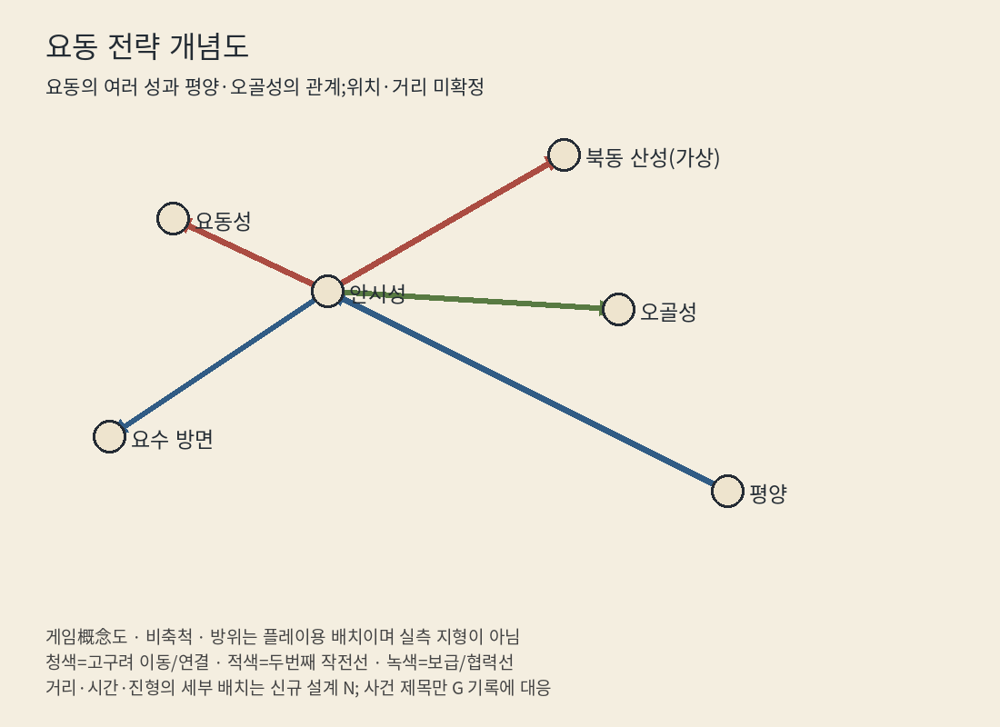

### 포위와 토산

START · 상대17일10:00

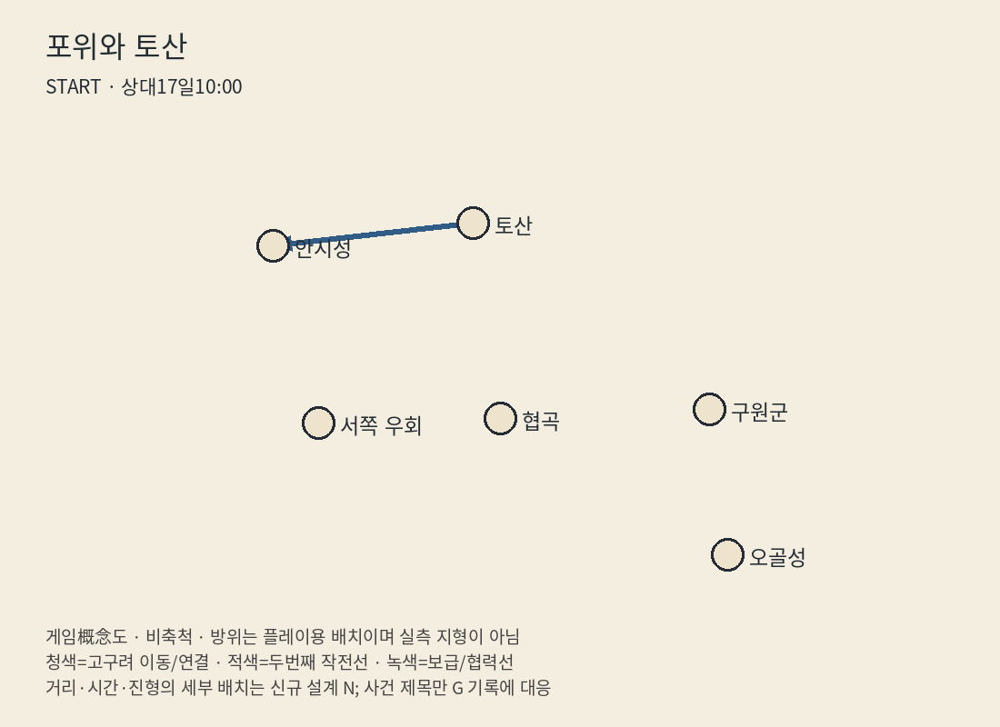

### 토산 역습

B004 · 상대17일13:40

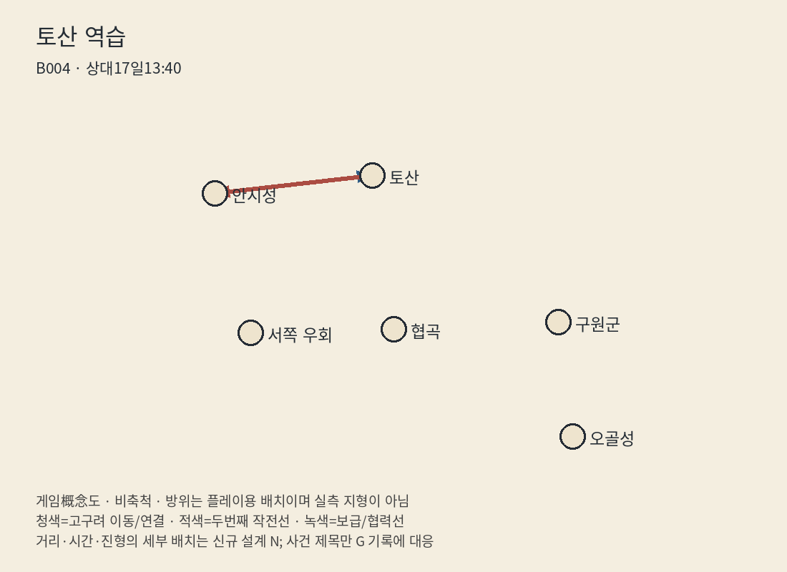

### 협곡 북쪽 접촉

B006 · 상대17일14:55

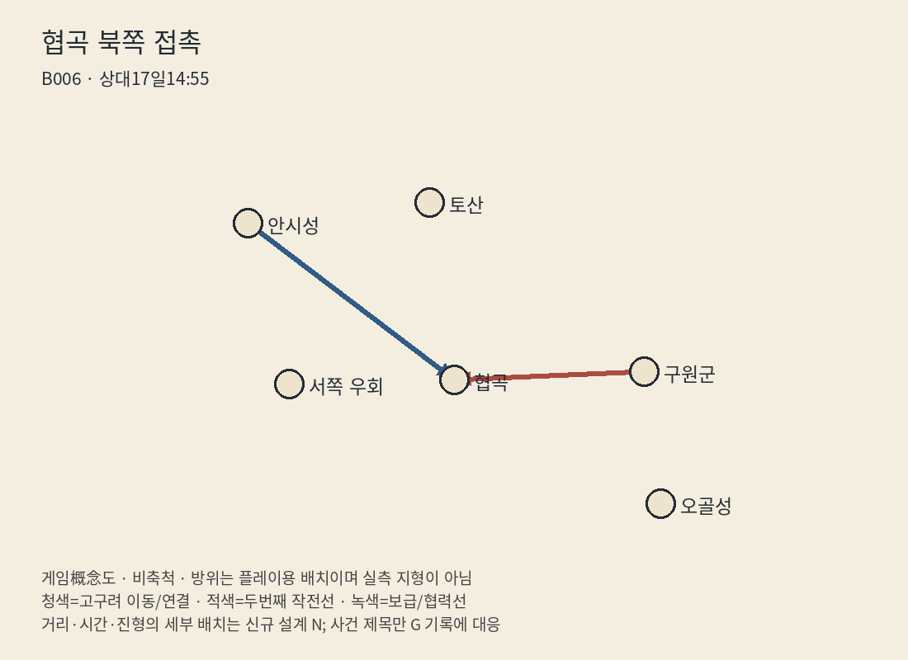

### 서쪽 우회

B007 · 상대17일15:18

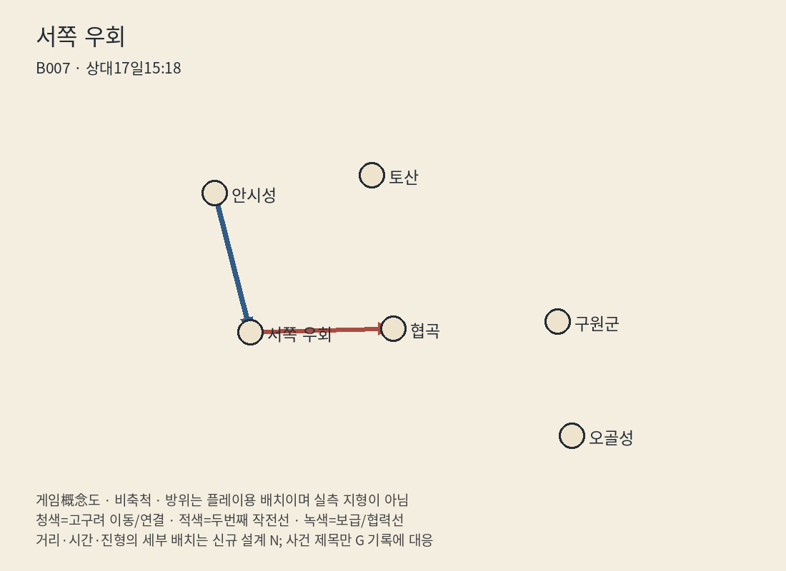

### 첫 방어선 돌파

B008R · 상대17일15:51

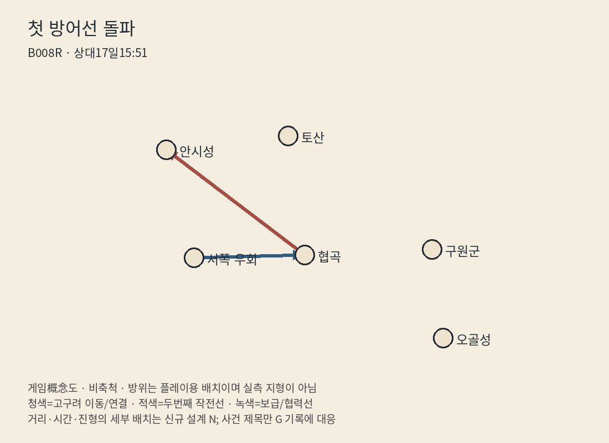

### 두 번째 방어선 돌파

B009 · 상대17일17:51

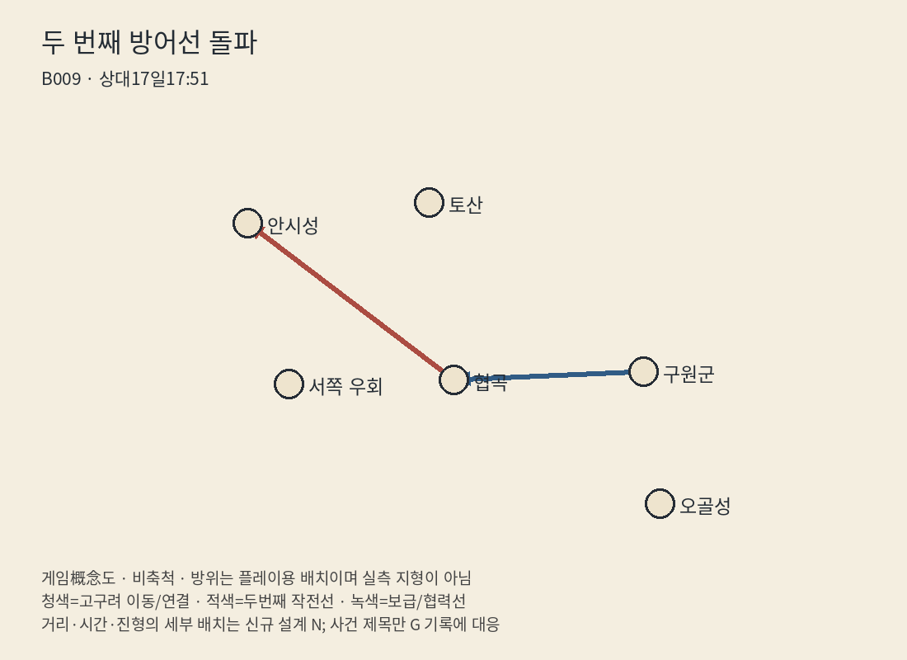

### 야간 협공·군량 합류

B010~011 · 상대17일 밤

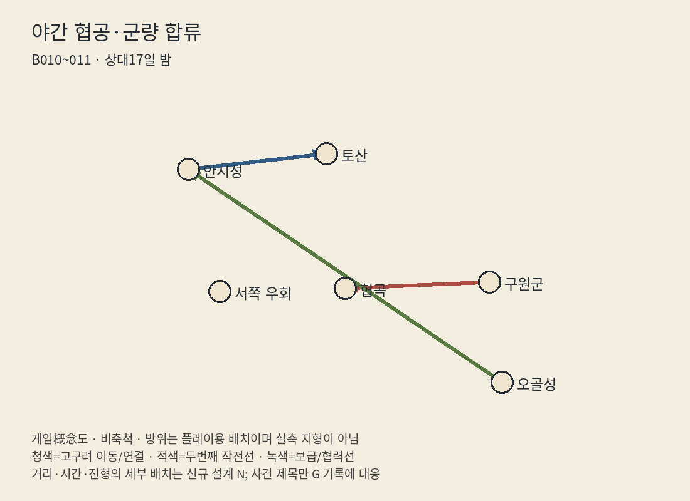

### 토산 붕괴·점령

B013~015 · 상대18일

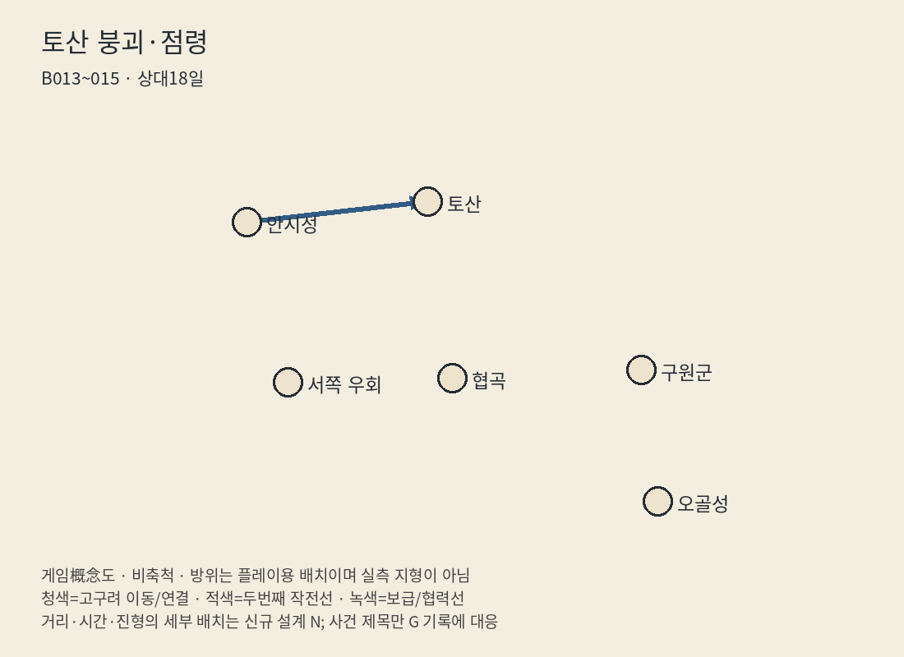

### 외곽 진지·차단선

B016~018 · 상대18~19일

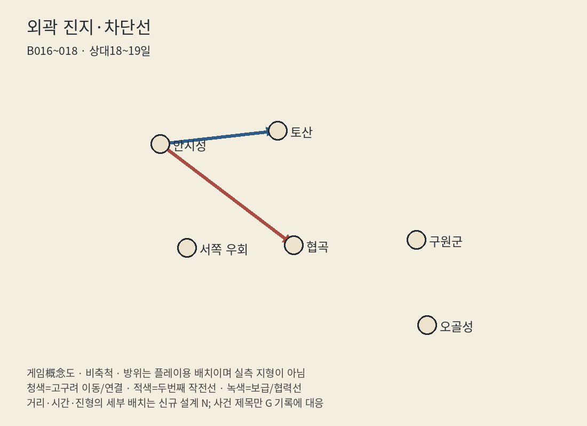

### 휴전과 철군

B020~023 · 상대19~20일

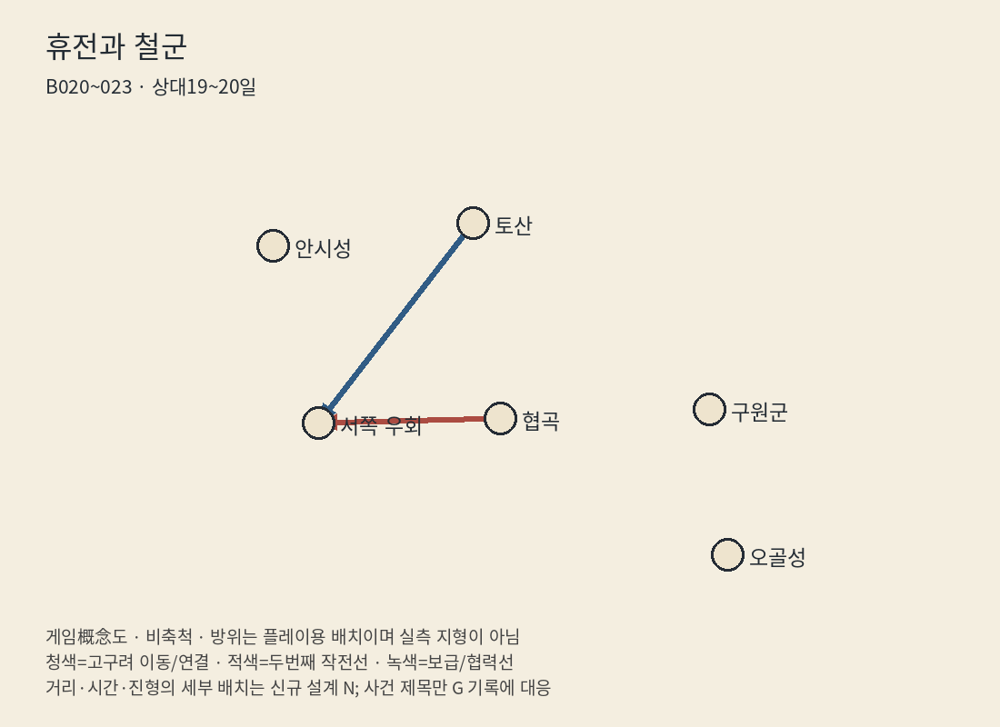

### 겨울 방어와 독립 거점

POST_003 · 상대150일13:00

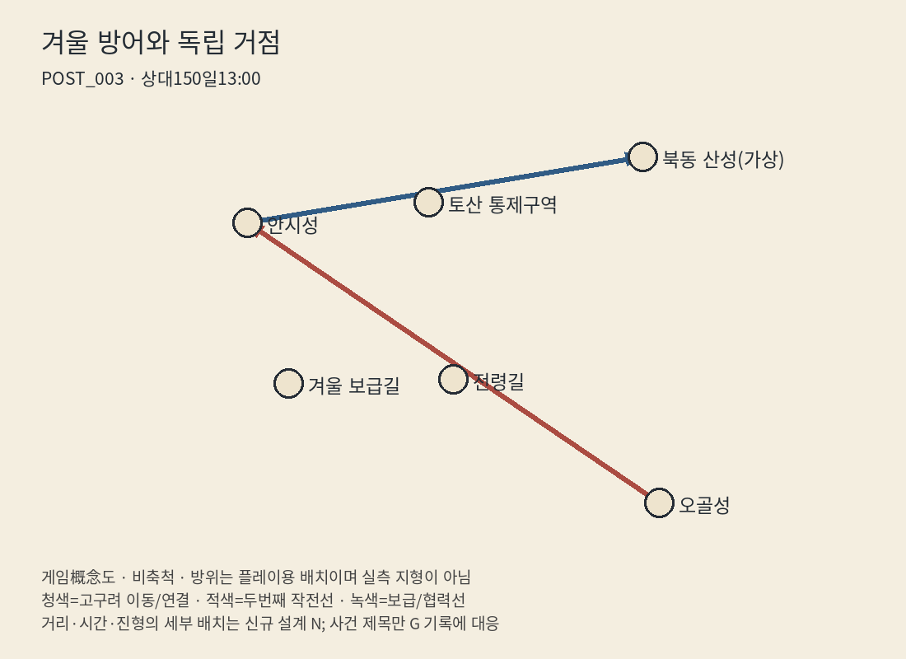
