# 인물 설정집 · HAEDONG v1.0

모든 외형·묘사 나이는 작품용 고정 디자인이다. 실존 인물의 실제 초상이 아니다. 능력치는 원문 미확인으로 null 유지한다. 연남생의 소년 배역을 유지한다.

## 양만춘

ID: yang_manchun / 분류: 전승 이름 / 배역: 안시성주

외형 고정: 48세 인상. 각진 넓은 얼굴·짧은 검은 수염·턱 회색·오른눈썹 위 흉터·남색 깃.

성격: 강직·신중·불굴.

열전: 보고의 빈칸을 지키며 전후 책임까지 맡는다.

반복 묘사 규칙: 얼굴·수염·깃 색을 고정한다. 계절에 따른 겉옷은 허용하되 식별 표지를 바꾸지 않는다.

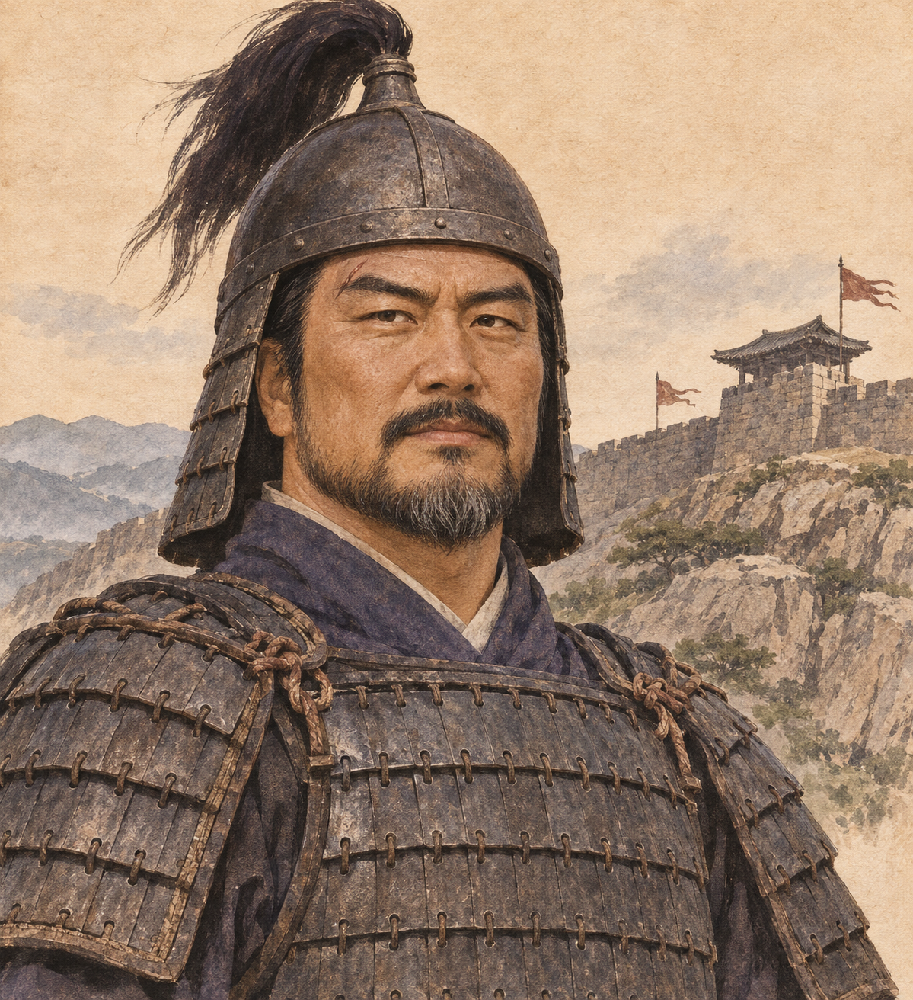

## 고무진

ID: go_mujin / 분류: 창작 / 배역: 성벽 수비대장

외형 고정: 45세 인상. 넓은 얼굴·왼볼 주름·무수염·갈색 깃.

성격: 인내·현장 중심.

열전: 성벽 수비와 주민의 복구 요구를 함께 조정한다.

반복 묘사 규칙: 얼굴·수염·깃 색을 고정한다. 계절에 따른 겉옷은 허용하되 식별 표지를 바꾸지 않는다.

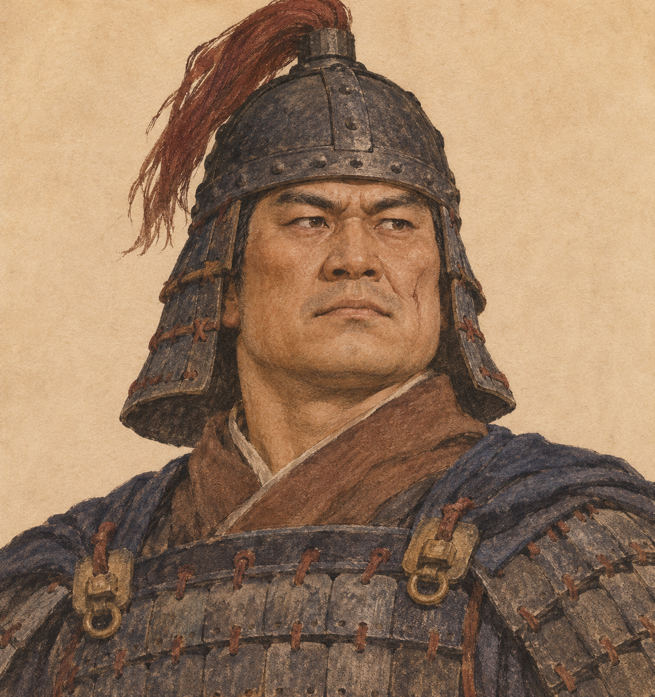

## 을두산

ID: eul_dusan / 분류: 창작 / 배역: 궁노병대장

외형 고정: 42세 인상. 긴 얼굴·가는 콧수염·회색 두건·올리브 깃.

성격: 관찰·절제.

열전: 적아 식별과 사격 중지를 공로로 인정한다.

반복 묘사 규칙: 얼굴·수염·깃 색을 고정한다. 계절에 따른 겉옷은 허용하되 식별 표지를 바꾸지 않는다.

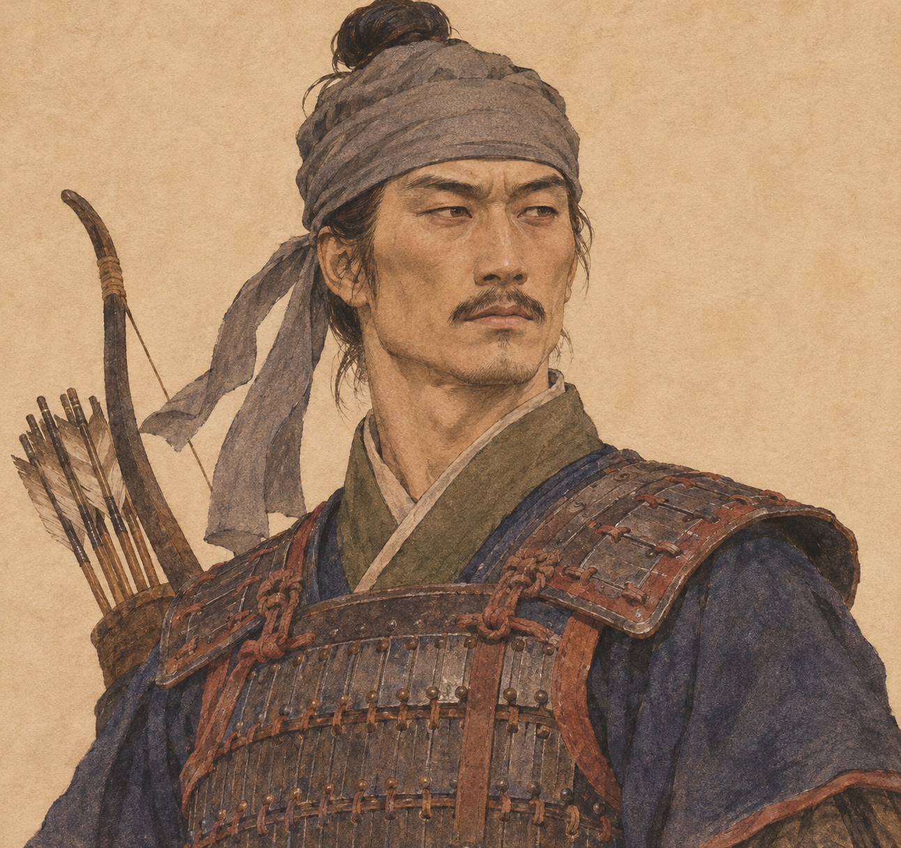

## 고연수

ID: go_yeonsu / 분류: 실존 이름·가상 배역 / 배역: 중장보병대장

외형 고정: 50세 인상. 넓은 이마·눈가 주름·짧고 풍성한 수염·황토 깃.

성격: 책임·견고함.

열전: 역사상의 행적과 다른 분기 B의 성내 지휘관.

반복 묘사 규칙: 얼굴·수염·깃 색을 고정한다. 계절에 따른 겉옷은 허용하되 식별 표지를 바꾸지 않는다.

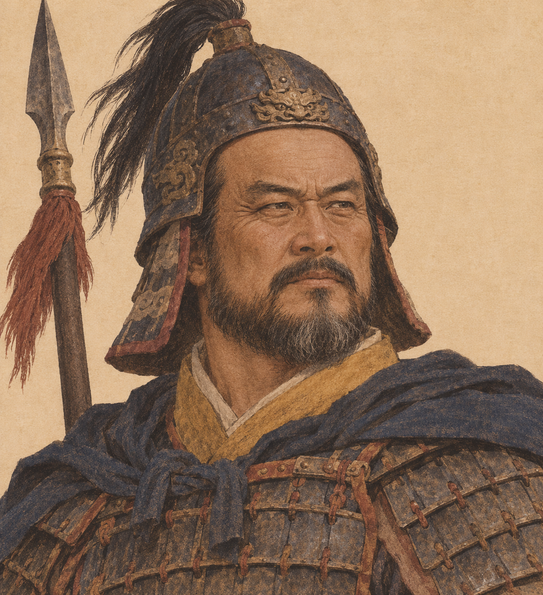

## 해명진

ID: hae_myeongjin / 분류: 창작 / 배역: 기동 타격대장

외형 고정: 34세 인상. 각진 마른 얼굴·턱 그늘·남색 목천.

성격: 대담·귀로 중시.

열전: 돌파와 절제를 배워 휴전 뒤에도 경계를 지킨다.

반복 묘사 규칙: 얼굴·수염·깃 색을 고정한다. 계절에 따른 겉옷은 허용하되 식별 표지를 바꾸지 않는다.

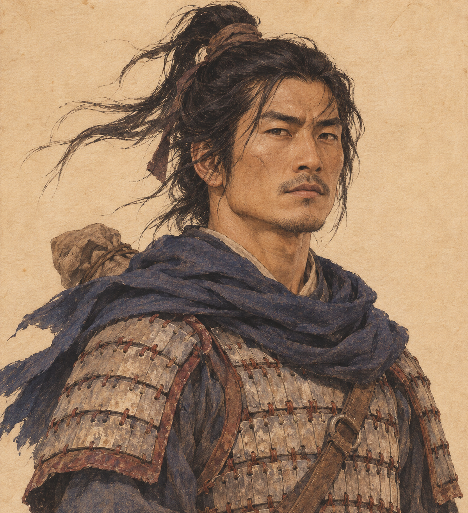

## 목철

ID: mok_cheol / 분류: 창작 / 배역: 공병대장

외형 고정: 46세 인상. 네모난 코·굵은 눈썹·손의 화상·갈색 작업복.

성격: 실증·검소.

열전: 붕괴의 원인을 과장하지 않으며 생활도구를 고친다.

반복 묘사 규칙: 얼굴·수염·깃 색을 고정한다. 계절에 따른 겉옷은 허용하되 식별 표지를 바꾸지 않는다.

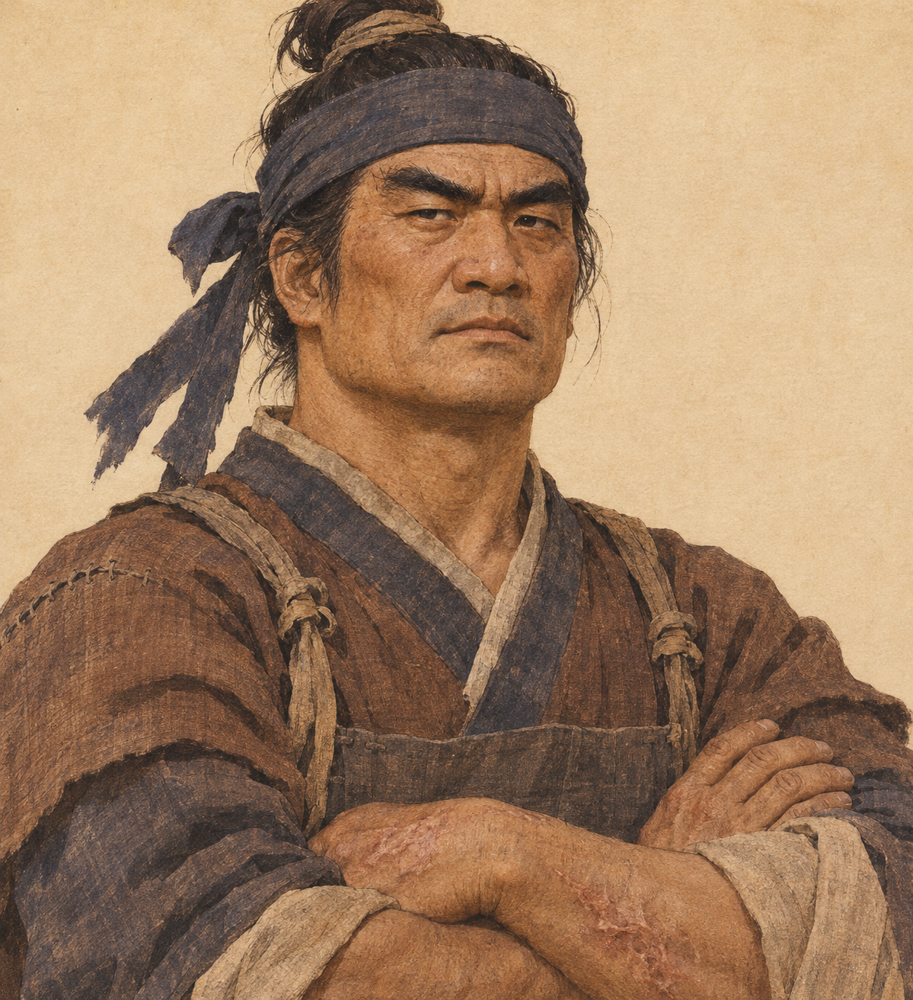

## 양덕

ID: yang_deok / 분류: 게임 창작 / 배역: 예비대장→북동 산성주

외형 고정: 29세 인상. 젊은 타원 얼굴·성긴 수염·짙은 녹색 깃.

성격: 신중·규율.

열전: 남은 자리를 채우던 장수에서 독립 책임자로 성장한다.

반복 묘사 규칙: 얼굴·수염·깃 색을 고정한다. 계절에 따른 겉옷은 허용하되 식별 표지를 바꾸지 않는다.

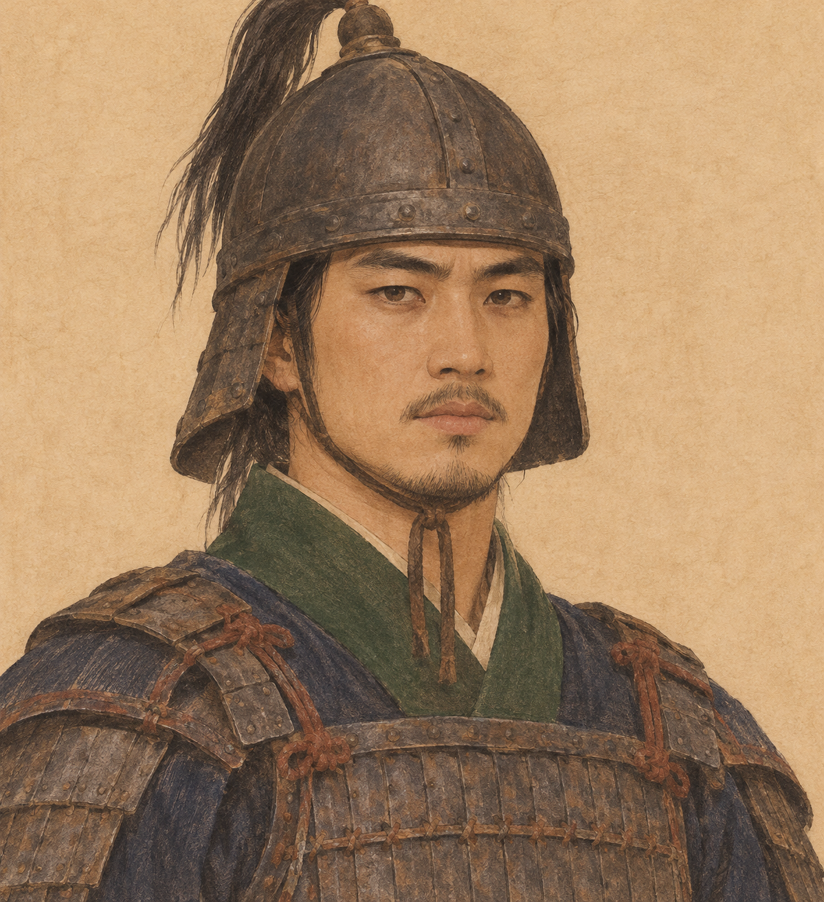

## 고진무

ID: go_jinmu / 분류: 게임 창작 / 배역: 신임 예비대장

외형 고정: 31세 인상. 좁은 타원 얼굴·무수염·갈색 깃.

성격: 과묵·질서.

열전: 전임의 체계를 이해하고 마지막 인계를 완수한다.

반복 묘사 규칙: 얼굴·수염·깃 색을 고정한다. 계절에 따른 겉옷은 허용하되 식별 표지를 바꾸지 않는다.

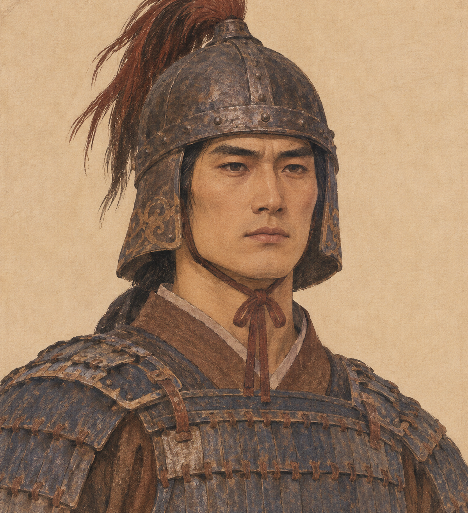

## 고정무

ID: go_jeongmu / 분류: 창작 / 배역: 독립 구원군 지휘관

외형 고정: 47세 인상. 둥근 풍상 얼굴·짧은 수염·닳은 검은 망토.

성격: 독립 판단·협력.

열전: 성주의 요청과 현장 사정을 함께 고려한다.

반복 묘사 규칙: 얼굴·수염·깃 색을 고정한다. 계절에 따른 겉옷은 허용하되 식별 표지를 바꾸지 않는다.

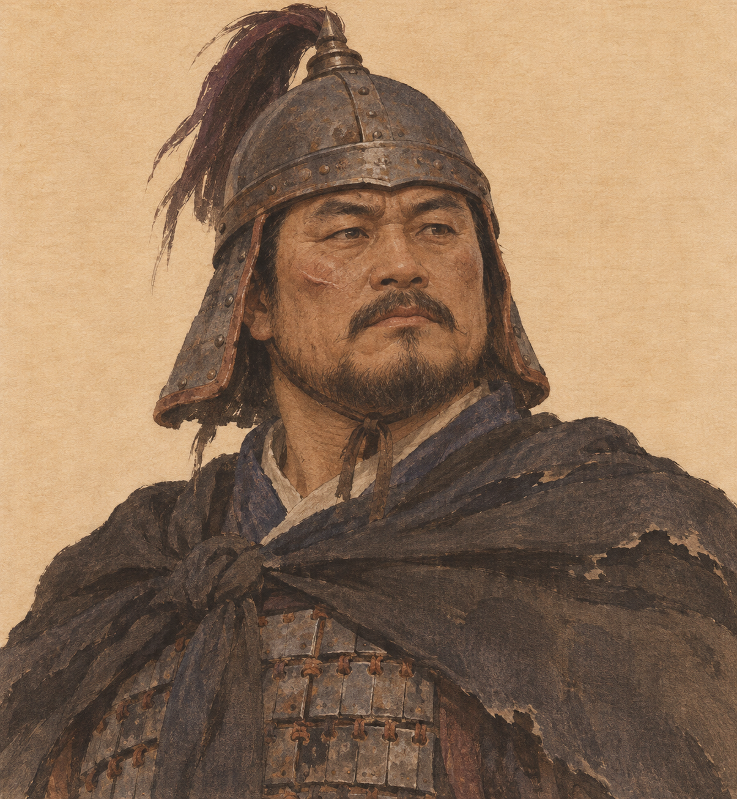

## 고진성

ID: go_jinseong / 분류: 창작 / 배역: 구원군 선발대장

외형 고정: 32세 인상. 삼각형 얼굴·짙은 눈썹·무수염·짙은 적색 목천.

성격: 기민·책임.

열전: 개인의 용맹보다 통로 전체의 생존을 택한다.

반복 묘사 규칙: 얼굴·수염·깃 색을 고정한다. 계절에 따른 겉옷은 허용하되 식별 표지를 바꾸지 않는다.

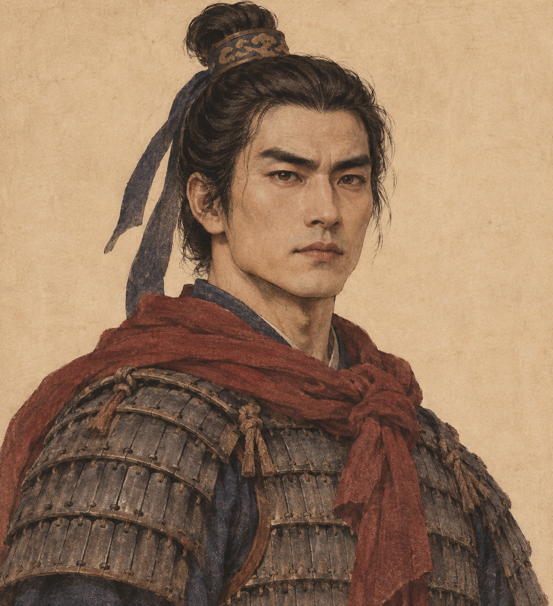

## 보장왕

ID: bojang / 분류: 실존 / 배역: 고구려 왕

외형 고정: 40세 인상. 긴 얼굴·가는 콧수염·절제된 적색 왕복.

성격: 신중·왕권 의식.

열전: 왕명·포상 장면의 정치적 중심;대사는 창작.

반복 묘사 규칙: 얼굴·수염·깃 색을 고정한다. 계절에 따른 겉옷은 허용하되 식별 표지를 바꾸지 않는다.

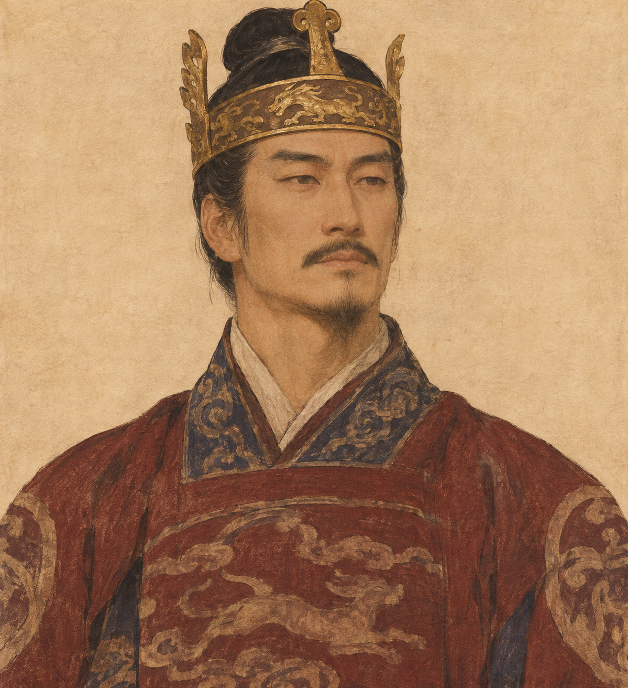

## 연개소문

ID: yeon_gaesomun / 분류: 실존 / 배역: 대막리지

외형 고정: 42세 인상. 넓고 엄한 얼굴·짙은 수염·검은 망토.

성격: 권력·경계.

열전: 본권은 조정의 시선으로만 암시;내면 사실로 단정 금지.

반복 묘사 규칙: 얼굴·수염·깃 색을 고정한다. 계절에 따른 겉옷은 허용하되 식별 표지를 바꾸지 않는다.

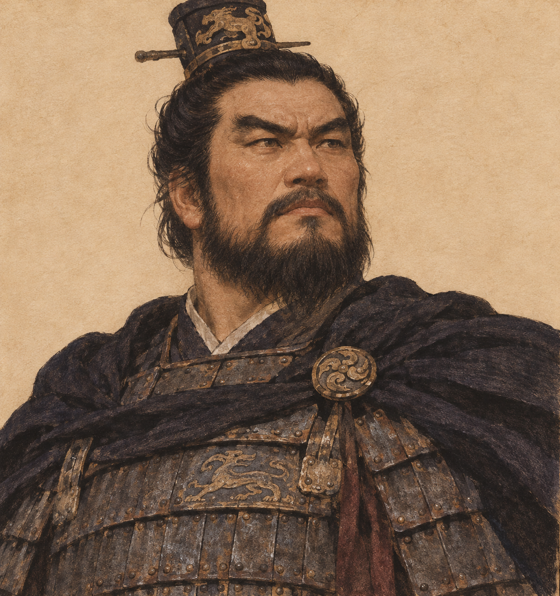

## 연남생

ID: yeon_namsaeng / 분류: 실존 / 배역: 연개소문 장남·설정집 수록

외형 고정: 11세 인상. 소년·둥근 얼굴·푸른 귀족 평복·무수염.

성격: 관찰·미성숙.

열전: 645년에는 어린 인물;성인 전투 지휘 금지.

반복 묘사 규칙: 얼굴·수염·깃 색을 고정한다. 계절에 따른 겉옷은 허용하되 식별 표지를 바꾸지 않는다.

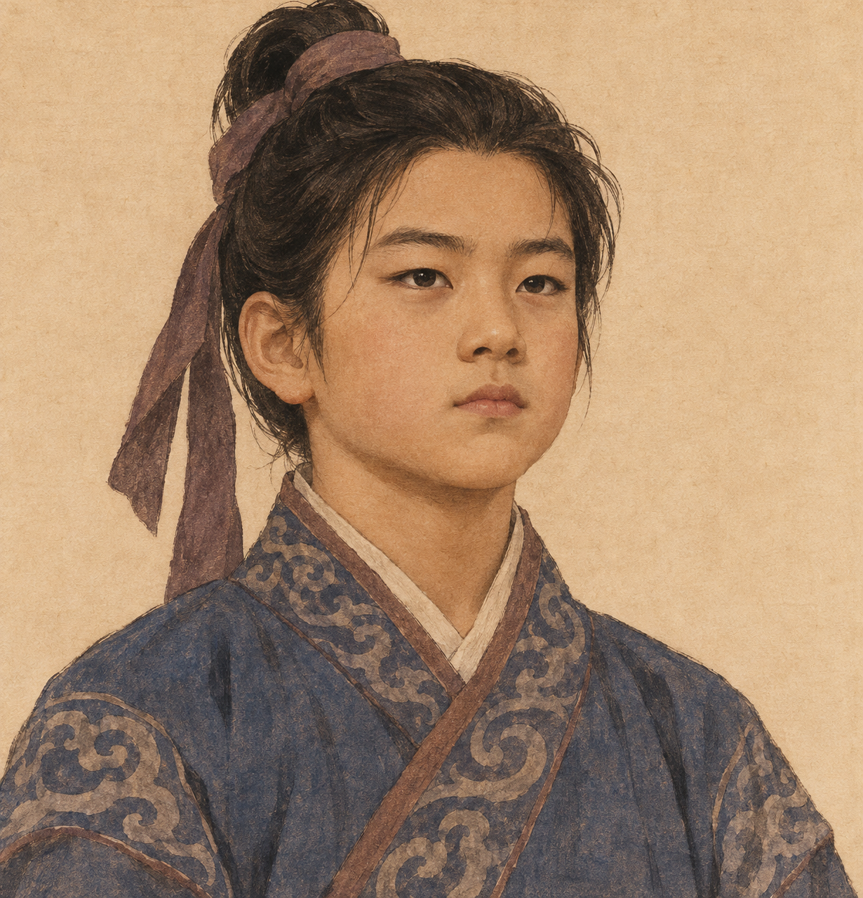

## 이세민

ID: li_shimin / 분류: 실존 / 배역: 당 황제

외형 고정: 47세 인상. 긴 강한 얼굴·콧수염과 턱수염·검은 관·자주색 옷.

성격: 자부심·현실 판단.

열전: 패배의 감정과 철군의 책임을 함께 감당한다.

반복 묘사 규칙: 얼굴·수염·깃 색을 고정한다. 계절에 따른 겉옷은 허용하되 식별 표지를 바꾸지 않는다.

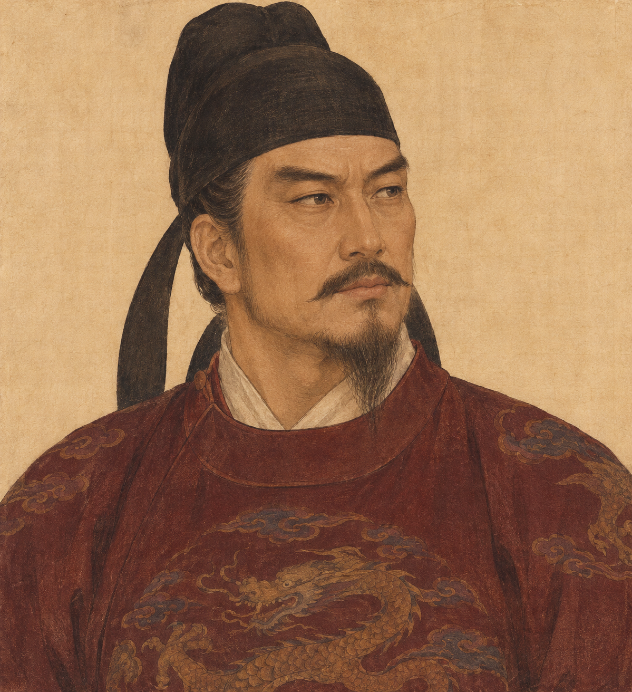

## 이세적

ID: li_shiji / 분류: 실존 / 배역: 당 장수

외형 고정: 51세 인상. 마른 긴 얼굴·회색 섞인 수염·남색 깃.

성격: 절제·실무.

열전: 철군의 질서를 강조한다.

반복 묘사 규칙: 얼굴·수염·깃 색을 고정한다. 계절에 따른 겉옷은 허용하되 식별 표지를 바꾸지 않는다.

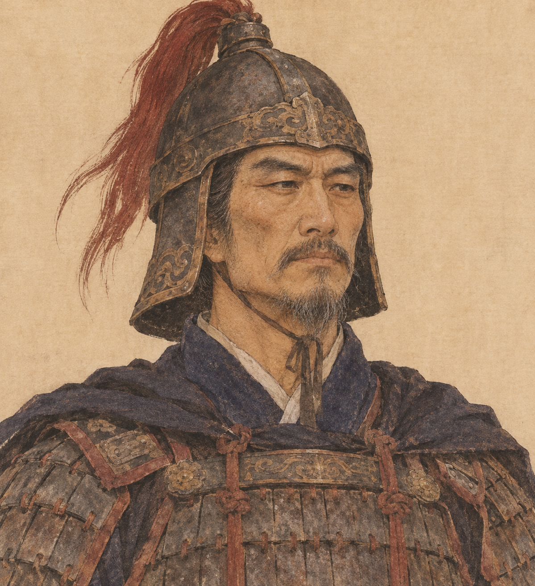

## 이도종

ID: li_daozong / 분류: 실존 / 배역: 당 장수

외형 고정: 45세 인상. 넓고 각진 얼굴·짧고 짙은 수염·적갈색 깃.

성격: 공세·자존심.

열전: 토산 상실 뒤의 반격 판단을 맡는다.

반복 묘사 규칙: 얼굴·수염·깃 색을 고정한다. 계절에 따른 겉옷은 허용하되 식별 표지를 바꾸지 않는다.

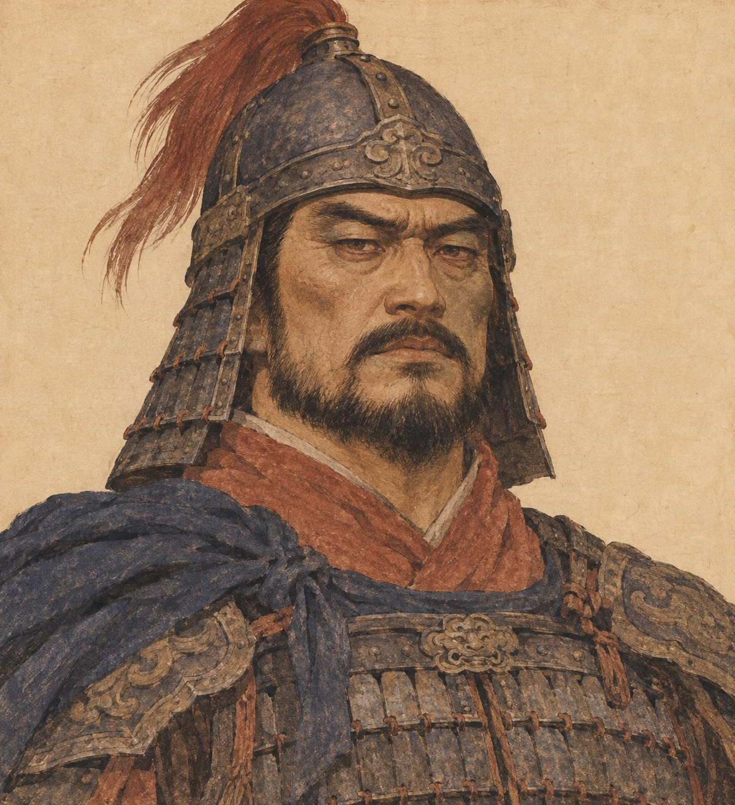

## 아사나사이

ID: ashina_sheer / 분류: 실존 이름·가상 배역 / 배역: 요격군 지휘관

외형 고정: 40세 인상. 높은 광대·짧은 수염·모피 테두리 투구·먹색 깃.

성격: 기동·냉정.

열전: 협곡 요격은 게임 창작 배역.

반복 묘사 규칙: 얼굴·수염·깃 색을 고정한다. 계절에 따른 겉옷은 허용하되 식별 표지를 바꾸지 않는다.

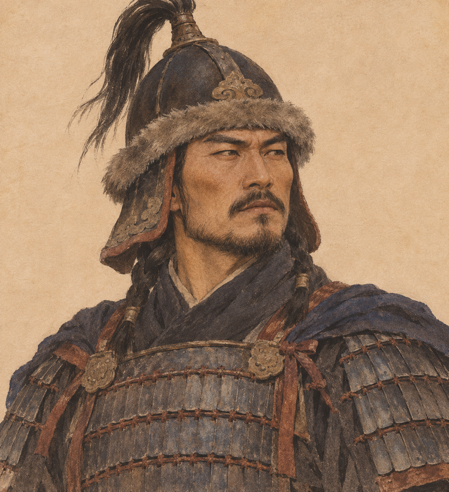

## 연이

ID: yeoni / 분류: 신규 소설 창작 / 배역: 치료소 조력자·솔의 누이

외형 고정: 22세 인상. 타원 얼굴·묶은 검은 머리·회색 삼베옷.

성격: 돌봄·정직.

열전: 적의 치료와 가족의 기다림을 함께 견딘다.

반복 묘사 규칙: 얼굴·수염·깃 색을 고정한다. 계절에 따른 겉옷은 허용하되 식별 표지를 바꾸지 않는다.

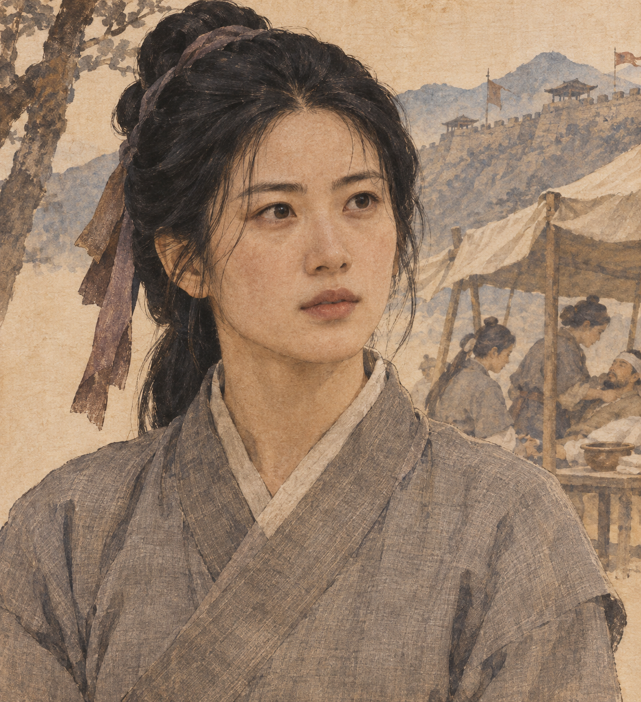

## 솔

ID: sol / 분류: 신규 소설 창작 / 배역: 성내 소년

외형 고정: 11세 인상. 작고 둥근 얼굴·짧게 묶은 머리·갈색 평복.

성격: 기억·질문.

열전: 바가지와 아버지의 이름을 지키며 글을 배운다.

반복 묘사 규칙: 얼굴·수염·깃 색을 고정한다. 계절에 따른 겉옷은 허용하되 식별 표지를 바꾸지 않는다.

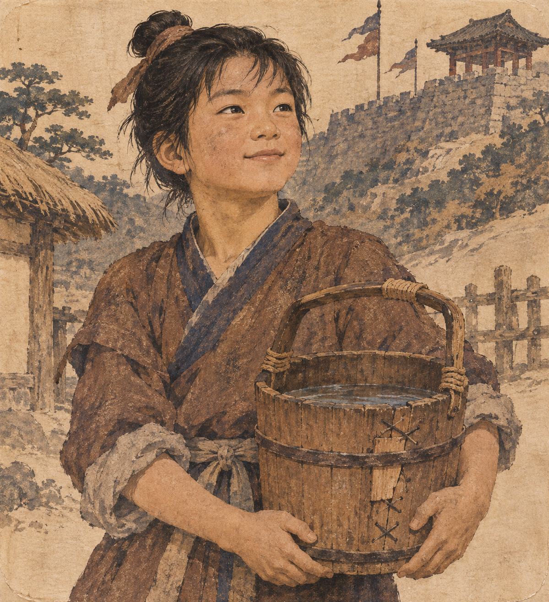

## 진륵

ID: jinle / 분류: 신규 소설 창작 / 배역: 당군 부상 포로

외형 고정: 27세 인상. 마른 긴 얼굴·수염 그늘·회색 전투복·팔 붕대.

성격: 두려움·생존.

열전: 표기와 발음이 미확실한 이름;교환 뒤 귀환한다.

반복 묘사 규칙: 얼굴·수염·깃 색을 고정한다. 계절에 따른 겉옷은 허용하되 식별 표지를 바꾸지 않는다.

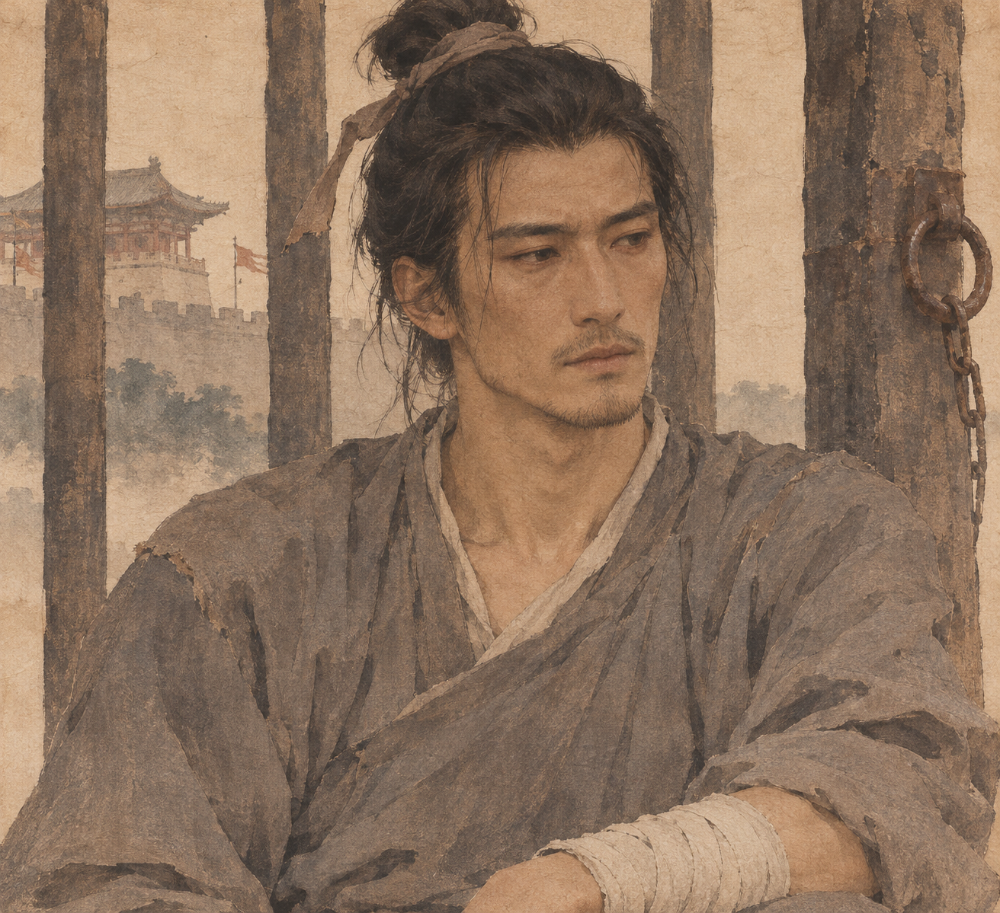